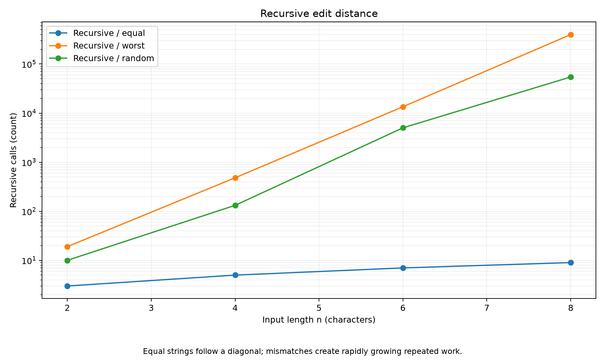
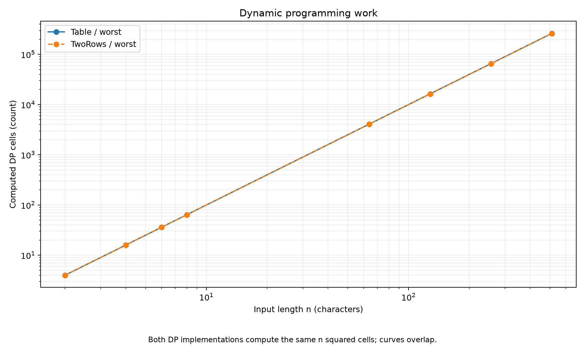
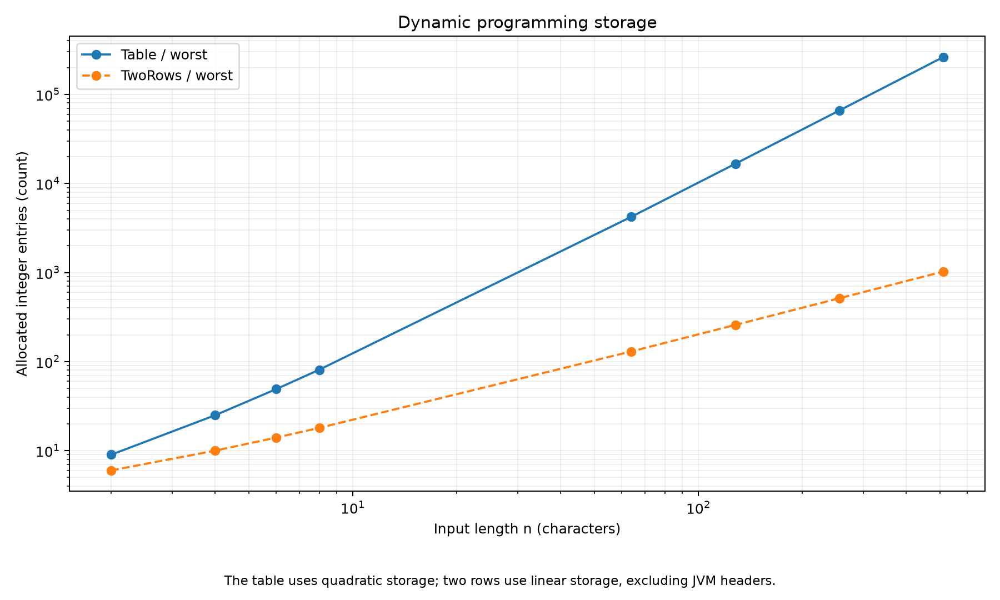
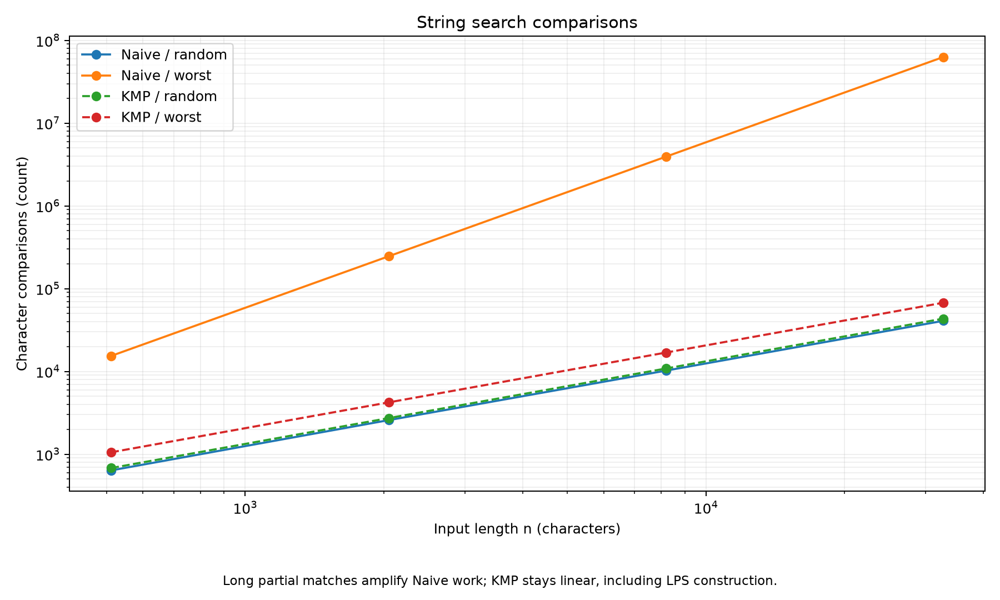

# Assignment 4 Report

## Experiment Design Card

| Field | Plan |
|---|---|
| Questions | Edit distance: how do recursion, DP work and DP storage grow with input size? String search: does KMP avoid repeated comparisons on long partial matches? |
| Sizes | Recursive: 2, 4, 6, 8. Table and TwoRows: 2, 4, 6, 8, 64, 128, 256, 512. Search: 512, 2048, 8192, 32768, with pattern length m = n / 16. |
| Reasons for sizes | Small common sizes allow comparison with recursion. Larger sizes reveal DP growth. Search sizes span a factor of 64 while keeping the experiment practical. |
| Edit inputs | Equal strings show the recursive diagonal path. A^n versus B^n forces branching. Independent random strings over A–D provide a contrasting mixed case. |
| Search inputs | Random inputs usually fail early. A^n versus A^(m-1)B forces long partial matches and repeated work in Naive. |
| Metrics | Recursive calls, computed DP cells, character comparisons, allocated integer entries and median time from three runs. |
| Predictions | Recursive branching grows exponentially. Both DP versions do quadratic work for equal-length inputs. Table storage is quadratic and TwoRows storage is linear. Naive is quadratic for the chosen difficult search inputs; KMP remains linear. |
| Plots | Recursive calls, DP cells, DP storage and search comparisons. Logarithmic axes make growth rates easier to compare. |

The design was recorded before the original experiment. The reported size lists and input families were retained. A fixed base seed of 42 is used, with seed 42 + n for each generated size.

Student: Orynbassarov Yerdan  
Group: SE-2525

## Method and Correctness

The three edit-distance implementations share the same interface. State D(i, j) means the minimum edit cost between prefixes of lengths i and j. The base cases are D(0, j) = j and D(i, 0) = i. The transition chooses deletion, insertion or replacement; equal last characters allow the diagonal value without an added cost.

Recursive recomputes states, Table stores all states, and TwoRows retains only the previous and current rows. Naive checks each start position. KMP builds LPS and uses previously matched prefixes when a mismatch occurs.

The JUnit suite contains 245 test cases, including 100 random edit-distance cases and 100 random search cases. It also checks the specified references, overlapping matches, empty inputs, invalid empty patterns and counter behavior. All 245 tests passed in the verification run.

Each of the 76 experiment configurations is measured three times, producing 228 CSV rows. Counters are updated inside the algorithms and checked for equality across repeated runs. Search comparisons include LPS construction.

## Plots and Results

### Recursive Work

Equal strings follow a diagonal, while mismatches cause rapidly growing repeated work.

For the difficult equal-length inputs, the measured call counts were:

| n | Recursive calls |
|---|---:|
| 2 | 19 |
| 4 | 481 |
| 6 | 13,483 |
| 8 | 398,593 |

Equal strings need only n + 1 recursive calls. This contrast shows why input structure matters even when lengths are identical.

### Dynamic Programming Work

Both DP versions compute the same number of interior cells, so their curves overlap.

At n = m = 512, both implementations computed 262,144 cells. Doubling both lengths multiplies this work by four. Unlike recursion, the number of computed DP cells does not depend on which characters match.

### Dynamic Programming Storage

The full table uses quadratic storage, while two rows use linear storage.

At n = m = 512, Table allocated 263,169 integer entries and TwoRows allocated 1,026. The table therefore used 256.5 times as many integer entries. These counts exclude JVM object headers, array references and recursion stacks.

### String Search Comparisons

Long partial matches cause repeated comparisons in Naive, while KMP retains linear growth.

For the difficult input with n = 32,768 and m = 2,048, Naive performed 62,916,608 comparisons. KMP performed 67,582 comparisons, including preprocessing. Both returned no matches because the text contains no B.

## Prediction Versus Result

For edit distance, the measurements support the predictions: branching recursion grows rapidly, both DP methods perform the same quadratic number of cell updates, and two rows greatly reduce storage. Equal strings are a useful exception to expensive recursion because this implementation follows only the diagonal. The experiment therefore does not justify calling recursion equally slow on every input.

For string search, the long partial-match input exposes the predicted difference. Because m grows with n, Naive's worst-case work is quadratic in n, while KMP's O(n + m) work is linear in n. Random inputs make Naive more competitive because most candidate positions fail quickly. KMP is therefore not guaranteed to use fewer comparisons on every small or random input.

## Short Answers

### Which input made string search slowest, and why?

The largest partial-match input was the slowest measured case for Naive. Its text contains only A, while its pattern ends with B after a long sequence of A characters. Naive repeats almost the entire pattern comparison at every candidate position. KMP uses LPS to reuse information about the already matched prefix.

### How large an n could recursive edit distance handle, and what stopped it?

The largest equal-length recursive benchmark tested was n = 8, and it completed successfully. This is a chosen experimental limit, not a measured maximum capacity of the machine. Already at that size, the difficult input required 398,593 calls. Larger difficult inputs were excluded to keep repeated experiments practical because the number of recursive calls grows exponentially.

### What do two rows gain and lose compared with the full table?

Two rows reduce auxiliary storage from O(nm) to O(m) for nonempty inputs while preserving the final distance. They still compute the same number of interior DP states. However, older states are overwritten, so this implementation cannot directly backtrack through the entire table to recover an edit sequence. Recovering that sequence would require additional information or a different reconstruction method.

### Which search algorithm would you choose for the city platform?

I would choose KMP for long log files and inputs whose structure is unknown. Its O(n + m) bound protects against repeated partial matches. It also supports overlapping occurrences without restarting the search from every position. Naive remains useful as a simple reference implementation and can be adequate for short inputs.

## Measured Time and Limitations

In the original verification run, the difficult n = 32,768 search had median times of approximately 18.631 ms for Naive and 0.405 ms for KMP. At n = 512, the difficult edit-distance input took approximately 0.609 ms with Table and 0.572 ms with TwoRows. These are reference-run measurements, not measurements from the student's laptop. Timing includes result validation, and the experiment has no dedicated JVM warm-up phase; compilation, garbage collection and scheduling can affect individual runs. Three-run medians reduce the influence of isolated delays, but operation counts provide stronger evidence for growth than small timing differences.

## Conclusion

The measurements demonstrate repeated work in plain recursion, the storage advantage of two-row DP and KMP's protection against long partial matches. Results, inputs and counters are reproducible with the fixed generator seed. Runtime values should be interpreted as environment-dependent observations.